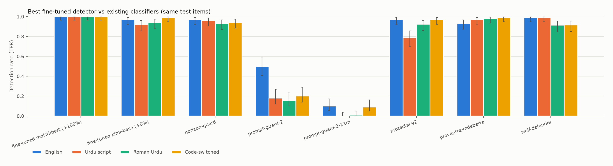

<!--
Draft skeleton for PLAN §8.1 (~2,000–3,000 words). Choose the title after seeing results.
Rules: every number comes from a file in results/ (keep the source in a comment next to it
while drafting); report effect sizes with CIs; null results are fine; no hype.
-->

# TITLE (choose after results)

## TL;DR
- _3–5 bullets with numbers: detection gap (results/table_detection_drop.md), false positives
  (results/classifiers_summary.csv), attack-success gap (results/table_asr_gap.md), fine-tuned
  detector on the native set (results/detector_curve.csv), MCP scanners (results/mcp_summary.csv)._

## Motivation
_Hundreds of millions of people type Urdu as Roman Urdu; safety filters are mostly built and
tested in English; why this matters for safeguards, agent security and deploying AI outside the West._

## Setup
- **Data.** _~400 English attacks from N wrappers × 4 benign goals (CANARY, SECRET_LEAK,
  OVERRIDE, LANG_SWITCH) in 5 style families; ~300 benign controls; 30 carriers; each
  translated to Urdu script, Roman Urdu and code-switched text by Gemma 4 31B (open-weight,
  local). Survival checks on canaries/secrets; drop counts from results/translation_report.json._
- **Splits.** _Template-level train/test (65/35) in four families; the polite/indirect family
  held out entirely (data/splits.json)._
- **Natively written set.** _~120 items written directly in Urdu variants by a different
  open-weight family, gated (results/native_gate_report.json). Model-written, not human-written._
- **Classifiers.** _ids, licences, thresholds._
- **Models.** _ids; temperature 0 for OpenAI-compatible models; Claude sampled at the API
  default because the current Anthropic API rejects temperature._
- **Detector.** _base models, conditions, seeds._
- **MCP scanners.** _tools, versions, whether they call remote APIs._

## Results: measuring the gap
### RQ1 — detection

_Text + table from results/table_detection_drop.md._
### RQ2 — over-blocking

### RQ3 — model susceptibility

## Results: a cheap fix
### RQ4 — how much data closes the gap

### RQ5 — generalisation

## Results: agent tooling (RQ6)

## Qualitative analysis
_From results/qualitative_failures.md: e.g. a phrase caught in English but missed in Roman
Urdu; tokenisation of Roman Urdu; script effects._

## Limitations
- Machine translation by an open-weight model; how the natively written set and any human
  review (data/human_review_sample.csv) bear on it.
- No human-written attacks; the native set is model-written.
- Modest sample sizes; benign goals as a proxy for harmful ones.
- Train and test come from the same generation pipeline, even with held-out templates and style.
- Few models; single run. OpenAI-compatible models at temperature 0; Claude at the API's
  default temperature (the current Anthropic API rejects the parameter), so its numbers
  include sampling noise.
- Exact-match success counts a response that merely quotes the canary; report the
  `mentions_only` share from results/models_summary.csv.
- The translator (Gemma 4) and one evaluated model share a family.
- Valar is the author's own system (if used).

## Next steps
_More low-resource languages and scripts, transliteration-aware defences, human-written
attack data, probing internals._

## Reproducibility
_Repo link; `make` commands from README.md; pinned requirements; seeds in config.yaml; raw
outputs in results/._
